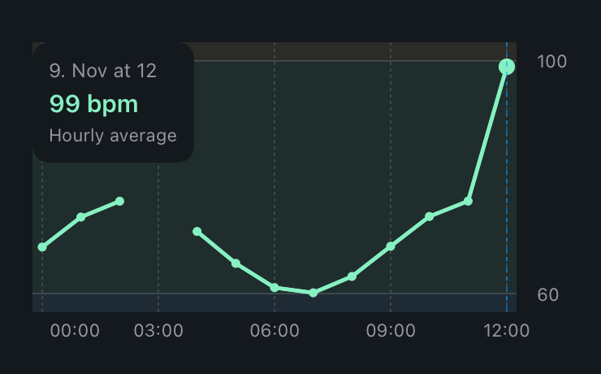

# My PEAQ

An unofficial iPhone companion for the **PEAQ PSR 100** smart ring. It reads the ring over Bluetooth and keeps history on your iPhone.

- **Today** shows activity goals, recent readings, and hourly or daily trends. Open the calendar to browse saved days.
- **Insights** shows recorded sleep stages, the ring’s PAI score, and saved exercise sessions when available.
- **My ring** shows connection status, battery, firmware information, and shareable diagnostics.
- **Settings** holds activity goals, the optional reference profile, and the foreground sync interval.



## Build and run

The project targets **iOS 17 or later** and was built with **Xcode 26.6**. A physical iPhone and PSR 100 are needed for Bluetooth. The simulator can run the UI and storage tests.

1. Open `PeaqRing.xcodeproj` and select the `PeaqRing` scheme.
2. To run on your iPhone, select your development team under **Signing & Capabilities**. Use a unique bundle identifier for your own build if required by Xcode.
3. Run the app, allow Bluetooth access, and open **My ring → Find my ring**. Select your ring from the results.
4. Use **Settings → Automatic sync** to choose the foreground interval. iOS schedules background refreshes.

For a local signing override that survives XcodeGen regeneration, create the ignored file `Config/LocalSigning.xcconfig` with your team:

```xcconfig
DEVELOPMENT_TEAM = YOUR_TEAM_ID
```

If you need a different app identifier, set it on the app target in Xcode or change the target’s `PRODUCT_BUNDLE_IDENTIFIER` in your local copy of `project.yml` and regenerate. The existing app uses its bundle identifier to locate its history and settings.

## Compatibility and data

- Bluetooth syncing has been checked with a physical PSR 100 on firmware **0.1.4**. Other models and firmware may have different services or require different authentication.
- History reads use known request commands. Background sync depends on iOS scheduling, Bluetooth access, and the ring being reachable. **Disconnect** pauses automatic reconnection until you reconnect or select a ring.
- Readings and settings are stored locally, with no account or server. New syncs store decoded records and discard raw packets. Older development builds may have retained local packet archives.
- **Connection diagnostics** includes service identifiers, revision information, and packet counts. Review the report before posting it publicly. Share synthetic examples rather than personal readings or app-container exports.
- Charts summarize the readings available from the ring. Sleep and device indices are estimates. Color bands describe duration, ring scores, personal baselines, or reference comparisons. Heart-rate history may include activity, even when compared with a resting reference.

## Development

The shared Xcode project is checked in. Use `xcodegen generate` after editing `project.yml`.

```sh
swift test

xcodebuild -project PeaqRing.xcodeproj -scheme PeaqRing \
  -destination 'generic/platform=iOS' \
  -derivedDataPath build/DerivedData CODE_SIGNING_ALLOWED=NO build

xcodebuild -project PeaqRing.xcodeproj -scheme PeaqRing \
  -destination 'platform=iOS Simulator,name=iPhone 16e' \
  -derivedDataPath build/DerivedData CODE_SIGNING_ALLOWED=NO test
```

Choose an installed simulator if needed. The Swift package tests the protocol and reference logic. The Xcode tests cover storage, migration, chart selection, and app navigation. GitHub Actions runs the protocol tests and an unsigned iOS build.

See [Bluetooth protocol notes](docs/protocol.md) for packet layouts and provenance.

## License

[MIT](LICENSE). My PEAQ is an independent project for use with the PEAQ PSR 100.
